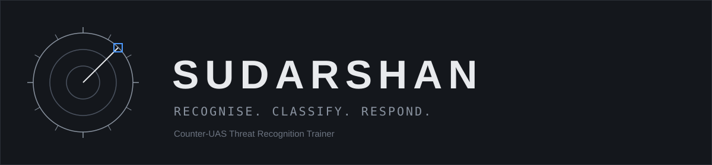
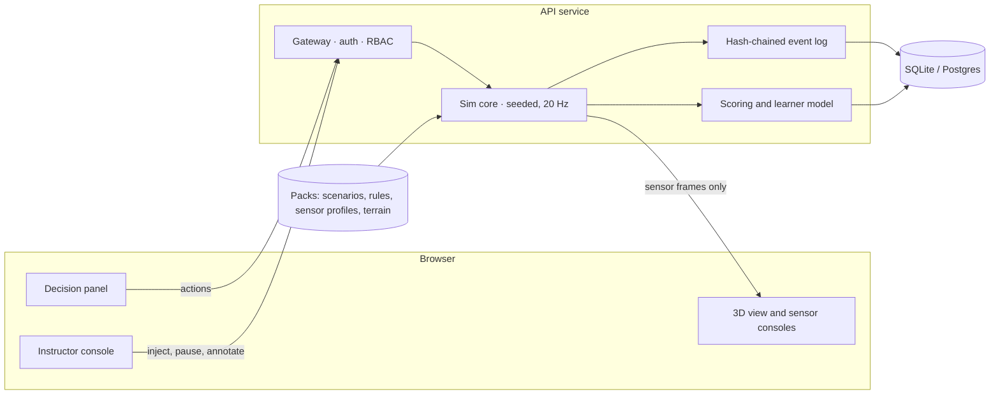

SUDARSHAN is a browser-based trainer for unit-level drone and counter-drone threat recognition. An operator and a detachment commander work a live picture built from simulated radar, EO/IR, RF and acoustic sensors, decide what each track is and what to do about it under a rule set, and are scored on every step of that decision. Scenarios are generated from a seed and checked for solvability, the trainer adapts to each trainee's weak points, and every session ends in an after-action review that shows what the trainee saw next to what was actually there. It runs on an ordinary laptop, offline, from one command.

Sensor models are calibrated from open research datasets and published specifications; all scenarios are authored or procedurally generated.

## Status

**In active development.** Planning is complete and the build is starting. Nothing below is available until its milestone is marked Done.

| Milestone | State |
|---|---|
| Planning pack, data register, decisions | Done |
| Wave 1 · Repo bootstrap | Not started |
| Wave 2 · Design system and app shell (first live link) | Not started |
| Waves 3–4 · Contracts, deterministic sim core, sensor models and fusion | Not started |
| Wave 5 · Live-session vertical slice | Not started |
| Waves 6–8 · Scoring and debrief, 3D realism and terrain, threat breadth | Not started |
| Waves 9–10 · Scenario engine, instructor console | Not started |
| Waves 11–12 · Adaptive learning, full after-action review and reports | Not started |
| Waves 13–14 · Team mode, trust and admin, WebXR and hardening | Not started |
| Wave 15 · Documentation and release 1.0 | Not started |

The authoritative state is [docs/BUILD_LOG.md](docs/BUILD_LOG.md).

## Capabilities

Every row is **Planned**. This table changes to **Available** only when the feature is merged, tested and deployed.

| Area | Capability | State |
|---|---|---|
| Simulation | Server-authoritative, deterministic 20 Hz simulation; identical seed and actions give an identical run | Planned |
| | Drone classes from hobby quadcopters to fixed-wing and swarms, plus birds and permitted civil traffic as clutter | Planned |
| | Day, night, thermal and night-vision looks; modelled weather; generic and fictionalised terrain | Planned |
| Sensors | Radar, EO/IR, RF and acoustic models with range, noise and degradation | Planned |
| | Track table, fusion, cross-cueing and a simulated AI assist that is sometimes wrong | Planned |
| Scenarios | Seeded procedural generator with an oracle-defender solvability check and a diversity check against the trainee's history | Planned |
| | Scenario library, editor and rule-pack editor with versioning | Planned |
| Scoring | Explainable decision-tree scoring: Detect, Classify, Assess, Respond | Planned |
| | Rules-of-engagement gate with the rule text shown when an action is blocked; signal-detection metrics | Planned |
| Adaptive training | Per-skill proficiency model, spaced repetition and a recommended next drill | Planned |
| | Recognition library with signature views generated from our own sensor models | Planned |
| After-action review | Seen-versus-truth split replay, decision path per threat, confusion matrix, reaction-time curves, miss-zone map | Planned |
| | PDF and CSV export; hash-chained, signed session records | Planned |
| Instructor tools | Cohorts, curricula, live monitor with ground-truth overlay, pause, injects, annotations | Planned |
| Team mode | Operator and detachment-commander roles, sector split, track handoff | Planned |
| Platform | English and Hindi UI, dark and light themes, keyboard-first operation, WCAG AA | Planned |
| | Offline LAN deployment with Docker Compose; SQLite or Postgres | Planned |

Further planned work beyond this baseline is catalogued in [docs/10-differentiators.md](docs/10-differentiators.md).

## How it works

The simulation runs on the server and owns the ground truth. The browser never receives it; it receives what the sensors would report, with noise, clutter and degradation applied. Because the run is seeded and deterministic, the same scenario, seed and action log reproduce the same session tick for tick. That one property supports replay, re-scoring, solvability checks and regression tests. Scenario packs, rule packs and sensor profiles are versioned, and every score records the versions that produced it. The full design is in [docs/05-architecture.md](docs/05-architecture.md).

## Screens

Placeholders until the first deployable slice is live; real screenshots replace them then.

| Screen | Purpose | Screenshot |
|---|---|---|
| Live session | 3D view, tactical map, sensor consoles, track table and decision panel on one workspace | Pending |
| Track table | Tracks with class, confidence, source sensors and ROE status | Pending |
| Generator studio | Difficulty vector, seed, solvability and novelty checks | Pending |
| Live monitor | Class grid, ground-truth overlay, injects and annotations | Pending |
| Unit after-action review | Seen-versus-truth replay, decision path, confusion matrix | Pending |
| Trainee progress | Per-skill proficiency and recommended next drill | Pending |

## Tech stack

| Layer | Choice |
|---|---|
| Web | React, TypeScript (strict), Vite, Tailwind, Three.js, MapLibre GL, i18n (EN/HI), Vitest |
| API | Python 3.12, FastAPI, SQLAlchemy 2, Alembic, Pydantic v2, uv |
| Simulation | Python, numpy, seeded RNG, 20 Hz tick |
| Database | SQLite by default; PostgreSQL 16 in Compose and production |
| Quality | pytest, ruff, mypy --strict, Playwright, axe-core, gitleaks |
| Delivery | Docker, Docker Compose, GitHub Actions |

## Getting started

There is nothing to run yet. Wave 1 adds the repository skeleton and the `make` targets; this section will list the exact commands as each wave lands, starting with the production-mode Compose stack and `make smoke` health checks.

## Documentation

- [Documentation index](docs/README.md)
- [Problem statement](docs/PS-26247.md) · [Requirements traceability](docs/06-requirements-traceability.md)
- [Architecture](docs/05-architecture.md) · [Engine decision](docs/04-engine.md) · [UI map](docs/07-ui-map.md)
- [Differentiators](docs/10-differentiators.md) · [Demo script](docs/08-demo.md)
- [Data register](docs/DATA_REGISTER.md) · [Decisions](docs/DECISIONS.md) · [Open questions](docs/OPEN_QUESTIONS.md)
- [Build log](docs/BUILD_LOG.md) · [Build waves](docs/waves/README.md)
- [Contributing](CONTRIBUTING.md)

## Roadmap

First, a deployable foundation: the repository, the design system and a live link. Then the core: a deterministic simulation, sensor models and a playable single-operator session. Then the training layer: scoring, realism, more threat types, the scenario engine and the instructor console. Then what turns a simulator into a training system: adaptive drills, full after-action review, team mode, signed records and administration. A pilot with 12 volunteers starts once the review is complete, and release 1.0 follows. Differentiating features are scheduled into these waves in [docs/10-differentiators.md](docs/10-differentiators.md).

---

Built for Smart India Hackathon 2026, PS 26247. Maintained by Shikhar Dixit.
