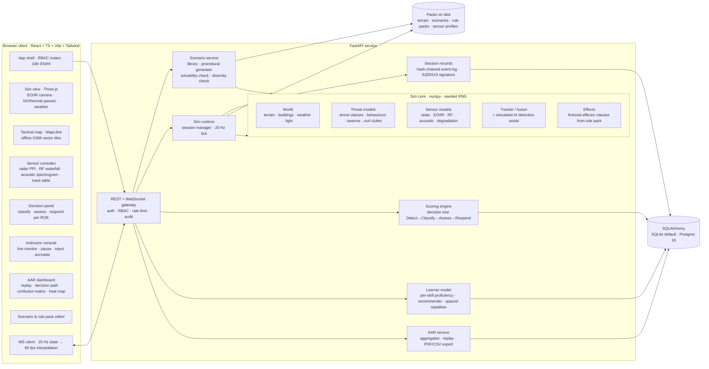
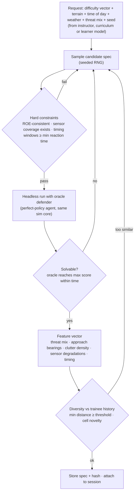
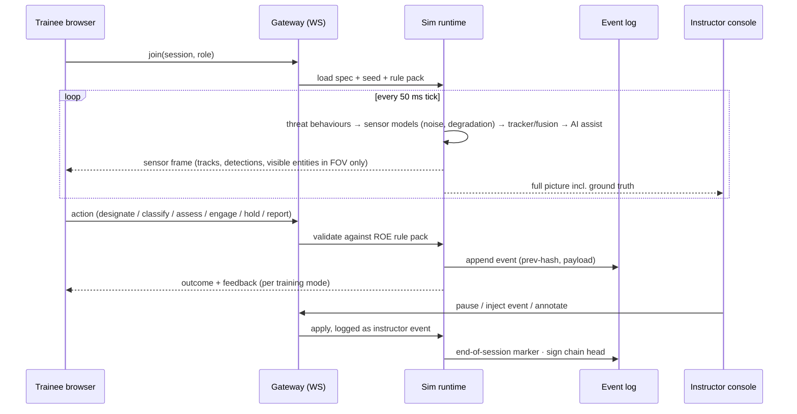
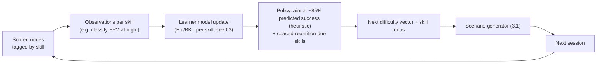
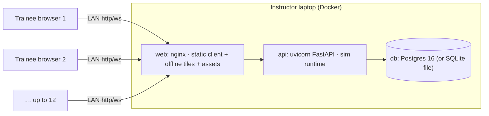

# 05 · Technical architecture

Platform: SUDARSHAN. Stack per project instructions; engine per 04.

## 1. Principles

1. **Server-authoritative simulation.** The Python sim core owns ground truth. The browser sees only what its sensors would report. This prevents cheating, and pause, inject, team mode and replay all come from one code path.
2. **Deterministic by construction.** Given the same scenario spec, seed and trainee-action log, the result is the same, tick for tick. Every replay, re-score and solvability check depends on this, and it is tested in CI.
3. **Everything versioned.** Scenario packs, rule packs (ROE plus scoring weights), sensor profiles and the learner model each carry a version. Every score records the versions that produced it.
4. **Offline first.** No CDN and no online tiles. One `docker compose up` on the instructor laptop serves the whole classroom over LAN.
5. **Honest by design.** Every reference value carries its source ID from the data register, and the UI shows a "fictional scenario · open-source parameters" label permanently.

## 2. Component diagram

## 3. Data flows

### 3.1 Scenario generation (procedural, solvable, diverse)

Retry budget: N attempts, then relax the softest constraint and log it. The spec stores the seed, generator version and every check result, so the AAR can show "this scenario was verified solvable".

### 3.2 Live session

### 3.3 Scoring

The event log and ground truth go into the decision-tree evaluator, which walks each threat's tree:

- **Detect**: time from first detectable moment to first designation.
- **Classify**: class correct? False alarms on clutter?
- **Assess**: threat level and intent correct?
- **Respond**: ROE-compliant action, effector choice and timing; hold fire on civil traffic.

Each node gets a score and a plain-language reason ("Detected 14 s after first radar return; standard 10 s"). The session score is the weighted sum, using rule-pack weights. Signal-detection metrics (hit rate, false-alarm rate, d′) are computed per class.

### 3.4 After-action review

The AAR replays the hash-verified log in a split view of **what you saw** (sensor frames) against **ground truth**. Beside the replay it shows the decision-tree path per threat, a confusion matrix, reaction-time curves and a miss-zone heat map. Aggregates roll up to trainee, cohort and unit across sessions, and export to PDF and CSV.

### 3.5 Adaptive difficulty loop

## 4. Deployment view

Production mode refuses demo accounts. The first admin is created from environment variables or `create-admin`. `/healthz` and `/readyz` are available. `make demo` seeds reference data from fixed seeds. the team prepares config and the owner deploys; you handle hosting (for a public demo: a Docker host with persistent storage; Vercel for the frontend needs `VITE_API_URL` at build time and `CORS_ORIGINS` set on the backend).

## 5. Key interfaces (contracts fixed in wave 1–2)

| Contract | Format | Versioned |
|---|---|---|
| Scenario spec | JSON Schema (`scenario.v1.json`) | yes |
| Rule pack (ROE + weights + thresholds) | YAML with JSON Schema validation | yes |
| Sensor profile | YAML, each parameter carrying a data-register source ID | yes |
| Sensor frame (WS) | MessagePack, typed in TS from Pydantic via codegen | yes |
| Event log record | `{seq, t, type, actor, payload, prev_hash, hash}` | yes |

## 6. PPT-ready slide description (one slide, 16:9)

- **Title:** "Architecture: one authoritative simulation, many views".
- **Layout:** three columns on a graphite background.
  - **Left column, "Classroom":** trainee and instructor browser tiles.
  - **Centre, a large box, "SUDARSHAN server":** the sim core drawn as four stacked bands (World, Threats, Sensors, Fusion + AI assist). On its right edge sit Scoring, Learner model and AAR. Across the bottom is a hash-chained log drawn as linked blocks.
  - **Right column, "Packs":** Scenario packs, Rule packs (ROE), Sensor profiles, Terrain.
- **Arrows:** a thin amber loop around the centre labelled "adaptive loop: score → skill model → next scenario". The only other arrows are grey.
- **Footer line:** "Runs offline on one laptop · LAN for 12 trainees · deterministic, replayable, signed".
- **Avoid:** cloud icons, 3D isometric clip-art and gradients. Use flat outlines with 1.5 px strokes and one accent colour.
