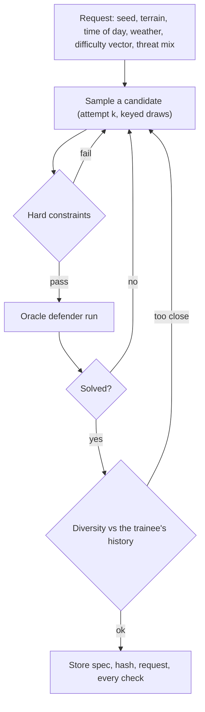

# Scenario engine

How scenarios are made, checked and shared: a seeded generator whose scenarios are **verified solvable by test run** and diverse against each trainee's history, a YAML scenario language with a validator and a linter, a scripted curriculum, and the instructor screens that use them. Code: `services/api/app/scenarios/` and the oracle's small hooks in `services/api/sim/`. Decision records: [ADR-008](DECISIONS.md#adr-008--scenarios-are-verified-solvable-by-test-run-not-provably-solvable), [ADR-024](DECISIONS.md#adr-024--pack-versions-are-locked-by-content-hash-and-recorded-with-every-session-and-score) (pack versions) and [ADR-025](DECISIONS.md#adr-025--the-oracle-defender-the-solved-criterion-and-where-scenarios-live).

**Honesty note.** Every scenario is fictional. "Verified solvable by test run" means a headless oracle defender cleared it in the sim; it is a practical check of what the oracle exercises, not a proof, and says nothing about how hard a scenario is for a person. Difficulty axes are project-authored heuristics, not measured. Sensor, threat and tracker numbers are reference data (Q-20, Q-22) and stay labelled so. The generated threat routes are kinematics only (locked rule 2): no guidance, targeting or terminal behaviour, and no route comes closer than a stand-off to the defended place.

## The oracle defender

`app/scenarios/oracle.py`. A perfect-policy agent on the same sim core, sensors, tracker and rules of engagement a trainee session uses, sending the same operator actions. It is a test agent, not a model of a person: it reads ground truth (which real drone a track follows, the true class and course) to make the calls a perfect operator would.

Policy, once per tick, for every track the truth ledger says follows a real drone (that is, once the track has three real reports behind it, which is also the earliest the scoring credits an action):

1. classify it as its true recognition class and assess it by its true disposition (`hostile`; `neutral` for civil and clutter contacts);
2. a hostile contact is reported at once, every field taken from the truth the scoring grades against, with a stated confidence of 1 (a perfect report is perfectly calibrated);
3. a hostile contact is engaged with the first effector class the permitting rule lists (the lowest escalation), the moment the rules permit it; the verdict is asked first, so a blocked attempt is never made;
4. a track error the tracker made is repaired: a swap by exchanging the labels, a split by merging the duplicate, so no unfixed error costs marks.

It stops a few seconds after the last hostile contact is answered. A run costs about 0.3 to 1 s.

### The solved criterion

Solvability is not "the oracle scored exactly 1.0": the first report of a drone can come from one lucky detection long before a track exists, and the scoring times every standard from that first report, so the sensors, not the operator, can cap the Detect and Classify marks. A scenario counts as **solved** when, in the oracle run:

| Check | Passes when |
|---|---|
| `hostile-presented` | every hostile contact was reported by a sensor |
| `hostile-answered` | every hostile contact was engaged under the rules |
| `no-failures` | no hard fail, no blocked attempt, no false engagement, no unfixed track error |
| `oracle-score` | every hostile contact's score is at least the request's `oracle_min_score` (default 80%; 100% asks for the scoring's maximum) |

Each check, with its value, is stored with the scenario and shown in the validation panel. The wording everywhere is "verified solvable by test run".

## The generator

`app/scenarios/generator.py`. `generate(request) -> GeneratedScenario`. Pure and deterministic: **the same request (which carries the seed) and generator version give a byte-identical spec** (canonical JSON, positions rounded to 0.1 m, keyed SHA-256 draws, no clock, no numpy random).



Hard constraints (rejection): the catalogue accepts every threat (`Catalogue.check_scenario`, limits from `Catalogue.limits_for`); the scenario contract validates; the linter finds no error (timing windows at least the minimum reaction time, every hostile contact inside some sensor's coverage, the rule pack can permit an engagement in a zone the scenario has, every waypoint reachable); every route keeps at least the stand-off from the defended place; each swarm's `link_range_m` covers its formation (so followers do not fall back to flocking).

**Retry budget.** `max_attempts` candidates (default 12) are tried at the requested constraint set. If none passes, the softest constraint is relaxed, logged in `relaxations`, and another `max_attempts` are tried. Order, softest first: the diversity threshold (halved, then dropped), then the difficulty targets (each axis widened by 15 points, then 30), then the oracle bar (never below 50%). Hard constraints and the solved checks other than the oracle bar are never relaxed. If the budget runs out the call fails with `GenerationFailed`, listing the last rejection of each kind; nothing unsolved is ever returned.

**Candidate.** A site (fictional name, asset at the origin, inner and outer zones sized to the terrain), a sensor suite chosen from the time of day and weather (radar always; day camera or night-vision and thermal; RF; acoustic), the clutter and civil traffic the ambiguity axis calls for, and the hostile contacts the threat load and mix call for:

| Archetype | What is drawn |
|---|---|
| `single` | one small rotary drone on an authored route |
| `swarm` | a leader-follower or leaderless formation of 6 to 24 small rotary drones (`loiter` or `transit` intent), `link_range_m` set to cover the formation |
| `fast-mover` | an FPV-class drone, fast and agile |
| `fixed-wing` | a small or medium fixed-wing drone on a long route |
| `decoy-mix` | a formation with a fraction of decoys among the real contacts |
| `silent-raid` | RF-silent autonomous drones, sometimes low-flying |

All routes are waypoint lists inside the class envelope that end by loitering at a stand-off or despawning.

## Features, diversity and the archive

`app/scenarios/features.py`, `diversity.py`, `archive.py`. A scenario's **feature vector** has eight axes, each normalised to 0..1 and computed from the spec alone (so a scripted scenario, a generated one and an authored one are comparable):

| Axis | Meaning |
|---|---|
| `threat_count` | hostile contacts (log scale, 24 = 1) |
| `id_ambiguity` | share of all contacts that are not a plain hostile drone (clutter, civil, decoys) |
| `approach_speed` | mean hostile cruise speed (40 m/s = 1) |
| `bearing_spread` | how spread the approach bearings are (0 one direction, 1 all round) |
| `clutter_density` | clutter contacts (20 = 1) |
| `degradation_load` | share of sensor-time degraded |
| `timing_tightness` | one minus the shortest reaction window over 300 s |
| `stealth` | share of hostile contacts that are RF-silent, decoys or low-signature |

**Diversity against the trainee's history.** The history is the feature vectors of the scenarios the trainee has played. A candidate's novelty is the mean distance (Euclidean over the eight axes, divided by the square root of eight so it is 0..1) to its `k = 3` nearest history vectors (all of them if fewer). A candidate is **rejected when it is closer than the threshold** (default 0.15). An empty history never rejects.

**MAP-Elites archive.** Over three of the axes: `threat_count` (6 bins) x `id_ambiguity` (6) x `approach_speed` (4) = 144 cells. Each cell keeps the best scenario that fell in it (quality: the oracle's lowest hostile contact score; ties keep the earlier). Reported: **coverage** (filled cells over all cells), **QD-score** (sum of the elites' quality) and **mean pairwise distance** (mean feature distance over all pairs of elites). The expressive-range heat map is one pair of axes with the best quality over the third.

## The scenario language

`app/scenarios/language.py`, `lint.py`. A scenario is `scenario.v1` written as YAML, with the same fields. The validator reports every contract error with its **line and column**; the linter adds domain checks, each with a code, a severity and the line of the offending node:

| Code | Severity | Fires when |
|---|---|---|
| `timing.reaction-window` | error | a hostile threat reaches the inner zone less than the rule pack's `respond_within_s` after it first becomes detectable (or after it spawns, if it spawns in view); a route that never enters the inner zone is measured to the end of the scenario |
| `coverage.none` | error | a hostile threat is never inside any sensor's coverage |
| `coverage.late` | warning | the first coverage comes after half the scenario |
| `roe.no-engage-rule` | error | no rule of the named pack can permit an engagement in any zone this scenario defines |
| `roe.zone-missing` | warning | a rule names a zone role the scenario has no zone for |
| `roe.pack-missing` | error | the rule pack the scenario names (id and version) cannot be loaded |
| `route.leaves-area` | error | a waypoint is outside the play area |
| `route.below-envelope` | error | a waypoint is below the lowest altitude the threat's limits and its catalogue class allow |
| `route.above-envelope` | error | a waypoint is above the highest altitude they allow |
| `route.speed` | error | a waypoint asks for more than the top speed they allow |
| `route.unreachable` | error | a hostile threat's route (not a loop) cannot be flown before the scenario ends |
| `route.underground` | error | a waypoint is below the terrain pack's ground |
| `catalogue.limits` | error | `Catalogue.check_scenario` reports a problem |
| `group.link-range` | warning | a group's `link_range_m` is less than the diameter of its members' start positions plus `spacing_m` |
| `sensor.profile` | error | a sensor profile is missing, not the version named, or cannot be built |
| `world.terrain-missing` | error | the terrain pack the scenario names cannot be loaded |

The linter reads planning estimates (`routes.py`, `coverage.py`), not the simulation, and runs inside the generator as a hard constraint. A clean lint is not a promise: the oracle run decides solvability. Members of a group fly the group's route, so a scripted swarm gives each member a route that follows the formation's, for the planning view to be meaningful.

**Seed sharing.** A short code carries the request, the seed and the generator version, for example `SD1-4F2K-...`; decoding it and generating again gives the identical spec (a code made by another generator version decodes but warns that the spec will differ).

## API

All under `/api/v1`. Authoring needs the `instructor` or `admin` role and a CSRF token on writes; `GET /scenarios` (the lobby list, wave 5) is unchanged. Request and response bodies are JSON. Errors are `{"detail": string}` or, for validation, `{"detail": [{"loc": [...], "msg": string}]}`. All text for people is `{en, hi}` where it comes from a pack and an English `message` plus a stable `code` where the engine writes it (the web app renders the `code` through its message catalogue).

| Method and path | Purpose |
|---|---|
| `GET /scenario-library` | list every scenario the instance holds |
| `GET /scenario-library/{id}` | one scenario: spec, YAML, lint, stored checks |
| `POST /scenario-tools/validate` | parse and lint YAML text |
| `POST /scenario-tools/check` | validate, oracle run and diversity for YAML text |
| `POST /scenario-tools/preview` | run the oracle on YAML text and return what happened |
| `POST /scenario-library` | save an authored scenario |
| `DELETE /scenario-library/{id}` | delete a saved (authored or generated) scenario |
| `POST /generator/generate` | generate one scenario from a request or a code |
| `POST /generator/batch` | generate several (up to 12) |
| `GET /generator/archive` | the MAP-Elites archive, its metrics and heat-map data |
| `GET /generator/code` | decode a share code to its request |
| `POST /generator/code` | encode a request to its share code |

### Shapes

```text
ScenarioSummary {
  id, version, title {en,hi}, summary {en,hi},
  origin: "scripted" | "generated" | "authored" | "example",
  playable: bool, tags: string[], curriculum_order: int | null, difficulty: int | null,
  terrain: "flat" | "heron-ridge" | "osprey-town",
  time_of_day: "dawn" | "day" | "dusk" | "night",     // from start_time_of_day_h
  weather: string, duration_s: number,
  hostile_count: int, contact_count: int, sensor_count: int, degraded: bool,
  group_count: int,
  rule_pack {id, version},
  solvability: { status: "verified" | "failed" | "unchecked",
                 oracle_score: number | null,           // lowest hostile contact score, 0..1
                 checked_at_run: string | null },        // "test run" wording; never "proof"
  can_delete: bool                                       // saved scenarios only
}

Check { name, passed: bool, value: number | string | null, detail: string, code: string }

LintItem { code, severity: "error" | "warning", line: int, column: int, message, params {} }

ValidationError { line: int, column: int, path: string, message, code }

ValidateResponse { valid: bool, errors: ValidationError[], lint: LintItem[], spec: ScenarioSpec | null }

CheckResponse {
  valid: bool, errors: ValidationError[], lint: LintItem[],
  solvability: { ran: bool, solved: bool, oracle_score: number | null,
                 checks: Check[], seconds: number, wording: "verified solvable by test run" | "not verified solvable" },
  diversity:   { history_size: int, novelty: number | null, threshold: number,
                 passes: bool | null, nearest: [{ scenario_id, distance }] },
  features: { [axis]: number }
}

PreviewResponse { ok: bool, finished_s: number, oracle_score: number | null,
  contacts: [{ id, label, disposition, class_id, first_report_s: number | null,
               answered_s: number | null, score: number | null }],
  path: { step_s: number, threats: [{ id, points: [[x, y, z], ...] }] },   // truth, instructor only
  coverage: [{ threat_id, first_s: number | null, sensors: string[] }] }

GeneratorRequest { seed, terrain, time_of_day, weather,
  difficulty { threat_load, ambiguity, speed, stealth, degradation },   // each 0..100
  threat_mix: ("single"|"swarm"|"fast-mover"|"fixed-wing"|"decoy-mix"|"silent-raid")[],
  oracle_min_score: 50..100, max_attempts: 1..64 }

GeneratedScenario {
  id, spec: ScenarioSpec, yaml: string, code: string, generator_version,
  request: GeneratorRequest, attempts: int, relaxations: string[],
  checks: Check[], solvability_wording: "verified solvable by test run",
  features: { [axis]: number }, diversity: { history_size, novelty, threshold, passes },
  spec_sha256: string, saved: bool
}

Archive { axes: [{ name, bins, labels[] }],             // the three archive axes
  cells: [{ index: [i,j,k], quality: number, scenario_id: string }],
  metrics { coverage, qd_score, mean_pairwise_distance, filled, total },
  heatmap { x_axis, y_axis, values: number[][] } }      // best quality over the third axis; null = empty
```

`POST /generator/generate` takes `{request?: GeneratorRequest, code?: string, save?: bool}` (exactly one of `request` and `code`); with `save` the scenario is stored, becomes playable and joins the archive. The diversity history is the signed-in user's played scenarios. `POST /generator/batch` takes `{request, count, save?}` and varies the seed by `count`.

## Where scenarios live

Pack scenarios (`packs/scenarios/*.json|yaml`) are read-only and shipped. Saved scenarios (authored in the editor or generated and kept) are rows of `scenario_records` (migration 0005): the spec JSON, its SHA-256, the YAML text, the request and code for a generated one, the stored checks and the owner. The session catalogue looks a scenario up in the packs first and then in the table, so a saved scenario is playable, replayable and scorable exactly like a pack one. Ids of generated scenarios are `gen-<seed>-<request hash>` and of authored ones are chosen by the author.

## Curriculum

`packs/scenarios/curriculum-*.v1.yaml`: scripted scenarios in YAML, each verified solvable by test run (a test runs the oracle on every one), covering day and night, degraded sensors, urban and rural terrain, a single drone and a swarm, in an order (`meta.curriculum_order`) that adds one idea at a time. Fictional sites and names; Hindi text is unreviewed (Q-15).

## Tests

| What | Where |
|---|---|
| Oracle policy, solved criterion, track repair | `tests/test_oracle.py` |
| Same request and version give a byte-identical spec; two processes agree | `tests/test_generator.py` |
| Oracle solvability on 50 seeds on every push, 1,000 nightly | `tests/test_generator_solvability.py`, `.github/workflows/nightly.yml` |
| Diversity rejects a candidate closer than the threshold | `tests/test_diversity.py` |
| Archive coverage, QD-score, mean pairwise distance, heat map | `tests/test_archive.py` |
| Lint reports the offending line; a code round-trips to an identical spec | `tests/test_lint.py`, `tests/test_sharecode.py` |
| Wording: no "provably" or "guaranteed" in any UI, doc or API string | `tests/test_scenario_wording.py` |
| Scripted curriculum is lint-clean and solved | `tests/test_curriculum.py` |
| Endpoints, roles, storage, catalogue lookup | `tests/test_scenario_api.py` |
| Screens: four states, keyboard, axe, EN and HI | `apps/web/e2e/mock/scenarios.spec.ts`, `apps/web/e2e/scenarios.spec.ts` |
